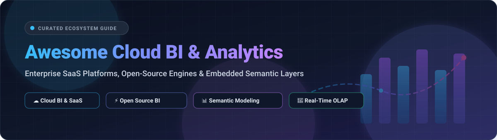

<div align="center">



# 📊 Awesome Cloud BI & Analytics ☁️

**A Curated Directory of Enterprise SaaS Platforms & Open-Source Cloud BI Analytics Engines**

<p align="center">
  <a href="https://github.com/ishandutta2007/Awesome-Awesome-Awesome"></a><a href="https://discord.gg/jc4xtF58Ve"></a>
  <a href="https://github.com/ishandutta2007/Awesome-Cloud-BI-Analytics/stargazers"></a>
  <a href="https://github.com/ishandutta2007/Awesome-Cloud-BI-Analytics/network/members"></a>
  <a href="https://github.com/ishandutta2007/Awesome-Cloud-BI-Analytics/issues"></a>
  <a href="https://github.com/ishandutta2007/Awesome-Cloud-BI-Analytics/blob/main/LICENSE"></a>
  <a href="https://github.com/ishandutta2007"></a>
</p>

*Empowering data teams, BI engineers, and modern analytics leaders with interactive dashboards, semantic layers, real-time OLAP engines, and embedded analytics solutions.*

</div>

---

## 🧭 Table of Contents

- [🌐 Sector Overview & Market Dynamics](#-sector-overview--market-dynamics)
- [☁️ SaaS & Hosted Platforms](#-saas--hosted-platforms)
- [⚡ Open-Source GitHub Projects](#-open-source-github-projects)
- [🏗️ Reference Modern BI Architecture](#-reference-modern-bi-architecture)
- [🤝 How to Contribute](#-how-to-contribute)
- [💖 Support](#-support)
- [📈 Star History](#-star-history)
- [📜 Disclaimer](#-disclaimer)

---

## 🌐 Sector Overview & Market Dynamics

The global Cloud Business Intelligence (BI) and analytics market is estimated at **$35 billion to $42 billion in 2026** and projected to exceed **$65 billion by 2030** (growing at a ~13–15% CAGR), driven by data lakehouse adoption, embedded analytics, and generative AI/agentic BI copilot workflows.

The sector exhibits **moderate fragmentation with high concentration at the top**: mega-cap cloud and business software incumbents (Microsoft, Google Cloud, and Salesforce) capture the lion's share of enterprise desktop and suite deployments through bundled distribution, while an active, fast-growing tier of independent specialized vendors (ThoughtSpot, Sigma Computing, GoodData) and community-driven open-source platforms (Apache Superset, Metabase, Cube, ClickHouse) vigorously compete for warehouse-native, embedded, and developer-first workloads without a single winner-take-all monopoly.

---

## ☁️ SaaS & Hosted Platforms

| Product | Company Size (Valuation / Revenue) | Starting Pricing | Free Tier / Trial Limits | Description |
| :--- | :--- | :--- | :--- | :--- |
| **[Microsoft Power BI](https://powerbi.microsoft.com/)** | ~$3.1T Market Cap (Microsoft) | $10/user/month (Power BI Pro) | Free forever (Power BI Desktop: local authoring and personal reporting, no cloud sharing/collaboration) | Business analytics platform integrated with Microsoft Fabric. Features Power BI Desktop, Power BI Service, Copilot AI, and Direct Lake mode. |
| **[Looker (Google Cloud)](https://looker.com/)** | ~$2.1T Market Cap (Alphabet) | $35,000/year (~$2,917/month base platform fee; Looker Studio Pro is $9/user/month) | 30-day free trial on Google Cloud with $300 trial credits; Looker Studio core is free with basic connector limits | Enterprise BI platform built on LookML semantic modeling language. Features Git integration, embedded analytics, and API governance. |
| **[Salesforce CRM Analytics (Wave)](https://www.salesforce.com/analytics/)** | ~$280B Market Cap (Salesforce) | $140/user/month (CRM Analytics Growth, billed annually) | 30-day free trial (pre-configured Salesforce environment with sample CRM analytics data) | Salesforce's native BI platform for CRM data. Features dashboards, dataflows, and AI-powered insights directly on Salesforce data. |
| **[Tableau Cloud](https://www.tableau.com/products/cloud-bi)** | ~$15.7B Acquisition Value (Salesforce) | $15/user/month (Tableau Viewer; Creator starts at $75/user/month, billed annually) | 14-day free trial (full Tableau Cloud features, web authoring, and Tableau Pulse) | Fully hosted analytics solution with Tableau Agent and Tableau Pulse. Features hybrid data connectivity via Tableau Bridge. |
| **[Qlik Sense](https://www.qlik.com/)** | ~$10B+ Valuation (Thoma Bravo) | $30/user/month (Standard plan, min. 20 users / billed annually) | 30-day free trial (full Qlik Cloud Analytics capabilities, up to 5GB in-memory data capacity) | Associative analytics engine with self-service visualization, guided analytics, and embedded analytics with open APIs. |
| **[ThoughtSpot](https://www.thoughtspot.com/)** | ~$4.5B Valuation (Latest round) | $25/user/month (Essentials plan, billed annually) | 30-day free trial (access to Spotter AI agent, Search, and live query connections) | Agentic analytics platform with Spotter 3 AI agent. Features natural language search and embedded analytics via SDK/API/MCP. |
| **[Sigma Computing](https://www.sigmacomputing.com/)** | ~$1.5B Valuation (Series D) | $15,000/year (Starter package; ~$1,250/month equivalent for Creator seats) | 14-day free trial (full live warehouse querying with sample datasets or connected cloud DWH) | Cloud-native analytics platform sitting directly on Snowflake, Databricks, and BigQuery with spreadsheet-like interface. |
| **[Sisense](https://www.sisense.com/)** | ~$1.0B Valuation (Unicorn valuation) | $10,000/year (~$833/month equivalent, base self-serve package) | 14-day free trial (access to web modeler, ElastiCube, and sample dashboard builders) | BI and analytics platform designed for embedded analytics. Features ElastiCube in-memory engine and BloX widget framework. |
| **[Domo](https://www.domo.com/)** | ~$400M Asset Sale / ~$160M Market Cap | $300/month (Standard consumption tier starting package) | 30-day free trial (enterprise capabilities with unlimited credits during evaluation) | Cloud-native BI and data product platform with 1,000+ connectors, Magic ETL, and App Catalyst. |
| **[GoodData](https://www.gooddata.com/)** | ~$63M ARR / ~$350M Total Funding | $1,500/month (Professional tier platform base fee) | 30-day free trial (GoodData.AI platform with unlimited users and DuckDB/Iceberg integration) | Composable analytics platform with Analytics Lake infrastructure, FlexConnect, and multi-tenant isolation. |

---

## ⚡ Open-Source GitHub Projects

*Ranked in descending order by GitHub_Stars.*

- **[Grafana](https://github.com/grafana/grafana)** [](https://github.com/grafana/grafana/stargazers)  
  Open-source operational analytics, data visualization, and observability platform (AGPL-3.0). Supports SQL databases, ClickHouse, Prometheus, and multi-source dashboarding with a rich community plugin ecosystem.

- **[Apache Superset](https://github.com/apache/superset)** [](https://github.com/apache/superset/stargazers)  
  Enterprise-ready cloud-native BI web application (Apache-2.0). Features an intuitive no-code chart builder, SQL Lab query editor, lightweight semantic layer, granular security permissions, and native connectivity to virtually any SQL database.

- **[ClickHouse](https://github.com/ClickHouse/ClickHouse)** [](https://github.com/ClickHouse/ClickHouse/stargazers)  
  High-performance, column-oriented real-time analytical DBMS (Apache-2.0). Powers ultra-low-latency OLAP queries, interactive dashboards, and real-time event analytics over billions of records.

- **[Metabase](https://github.com/metabase/metabase)** [](https://github.com/metabase/metabase/stargazers)  
  User-friendly self-service business intelligence and dashboarding tool (AGPL-3.0). Features visual query builders for non-technical users, Metabot AI assistance, automated alerts, and seamless embedding into SaaS apps.

- **[Streamlit](https://github.com/streamlit/streamlit)** [](https://github.com/streamlit/streamlit/stargazers)  
  Open-source Python framework (Apache-2.0) that turns data scripts into shareable web apps, custom analytical calculators, machine learning interfaces, and exploratory BI dashboards in minutes.

- **[Redash](https://github.com/getredash/redash)** [](https://github.com/getredash/redash/stargazers)  
  Open-source SQL query editor and visualization platform (BSD-2-Clause). Enables analysts to query data sources, build shareable dashboards with auto-refresh schedules, configure alert destinations, and integrate via REST API.

- **[Dash (Plotly)](https://github.com/plotly/dash)** [](https://github.com/plotly/dash/stargazers)  
  Enterprise-grade framework (MIT) for building interactive analytical web applications in Python, R, and Julia without writing JavaScript. Integrates deeply with Plotly charts and data science pipelines.

- **[Cube.js](https://github.com/cube-js/cube)** [](https://github.com/cube-js/cube/stargazers)  
  Universal semantic layer and headless BI platform (Apache-2.0). Provides centralized metric definitions, access control, pre-aggregations, SQL API, and GraphQL/REST APIs for building custom data apps and embedded BI.

- **[Apache Doris](https://github.com/apache/doris)** [](https://github.com/apache/doris/stargazers)  
  High-performance, real-time analytical database based on MPP architecture (Apache-2.0). Known for extreme simplicity, sub-second reporting over massive tables, and native vector execution.

- **[Apache Druid](https://github.com/apache/druid)** [](https://github.com/apache/druid/stargazers)  
  Distributed real-time analytics database (Apache-2.0) designed for sub-second streaming analytics and event-driven data architectures. Integrates natively with Apache Kafka and AWS Kinesis.

- **[Jupyter Notebook](https://github.com/jupyter/notebook)** [](https://github.com/jupyter/notebook/stargazers)  
  Interactive computational notebook environment (BSD-3-Clause) widely adopted for statistical modeling, exploratory data analysis, chart prototyping, and collaborative data storytelling.

- **[Trino](https://github.com/trinodb/trino)** [](https://github.com/trinodb/trino/stargazers)  
  Fast distributed SQL query engine for big data analytics (Apache-2.0). Executes federated interactive queries against data lakes (S3, Iceberg, Delta Lake), relational databases, and NoSQL systems.

- **[Databend](https://github.com/datafuselabs/databend)** [](https://github.com/datafuselabs/databend/stargazers)  
  Modern cloud-native elastic analytics engine and lakehouse data warehouse written in Rust (Apache-2.0), optimized for object storage and cost-efficient BI workloads.

- **[Evidence](https://github.com/evidence-dev/evidence)** [](https://github.com/evidence-dev/evidence/stargazers)  
  Code-driven business intelligence framework (MIT). Allows engineers to build fast, markdown-based reporting pages with SQL queries, component loops, and version-controlled Git workflows.

- **[Lightdash](https://github.com/lightdash/lightdash)** [](https://github.com/lightdash/lightdash/stargazers)  
  Modern open-source BI platform natively integrated with dbt (MIT). Converts dbt semantic models and YAML schemas into self-serve metrics, exploratory pivot tables, and interactive dashboards.

- **[Rill](https://github.com/rilldata/rill)** [](https://github.com/rilldata/rill/stargazers)  
  Fast operational BI tool and metrics engine built with DuckDB and Apache Arrow (Apache-2.0). Offers instant local profiling, code-based dashboards, and rapid cloud deployment.

- **[Malloy](https://github.com/malloydata/malloy)** [](https://github.com/malloydata/malloy/stargazers)  
  Experimental open-source data modeling language and query compiler (Apache-2.0) designed by the creators of Looker/LookML to synthesize complex nested aggregations and semantic data models.

- **[Knowage](https://github.com/KnowageLabs/Knowage-Server)** [](https://github.com/KnowageLabs/Knowage-Server/stargazers)  
  Open-source enterprise business analytics suite (AGPL-3.0). Supports enterprise reporting, self-service ad-hoc analysis, KPI performance cockpits, location intelligence, and predictive scripts.

---

## 🏗️ Reference Modern BI Architecture

Organizations looking for transparency, vendor autonomy, and high performance frequently combine open components into a custom stack:

```
┌────────────────────────────────────────────────────────┐
│                   BI & User Interface                  │
│       Apache Superset  •  Metabase  •  Evidence        │
└───────────────────────────┬────────────────────────────┘
                            │
┌───────────────────────────▼────────────────────────────┐
│                  Semantic & Metric Layer               │
│                  Cube.js  •  Lightdash  •  dbt          │
└───────────────────────────┬────────────────────────────┘
                            │
┌───────────────────────────▼────────────────────────────┐
│              High-Speed Real-Time OLAP / SQL           │
│        ClickHouse  •  Trino  •  Apache Druid / Doris   │
└───────────────────────────┬────────────────────────────┘
                            │
┌───────────────────────────▼────────────────────────────┐
│               Storage & Lakehouse Foundations          │
│        Apache Iceberg  •  Delta Lake  •  S3 / GCS      │
└────────────────────────────────────────────────────────┘
```

---

## 🤝 How to Contribute

Contributions are welcome! To suggest a new tool, report pricing updates, or refine categories:

1. 🍴 **Fork** this repository.
2. 🌿 Create a feature branch: `git checkout -b feature/add-new-tool`.
3. 📝 Update `README.md` following the standard table or list format with accurate citations and factual descriptions.
4. 🚀 Push your branch and open a **Pull Request**.

---

## 💖 Support

If you find this curated Cloud BI and Analytics collection helpful:
- ⭐ **Star this repository** to help others discover it!
- 🍴 **Fork and share** it with your data engineering, analytics, and BI communities.
- ☕ **Support future development:** If this project saved you time or added value to your research, you can support ongoing curation on the [GitHub Sponsor Dashboard](https://github.com/sponsors/ishandutta2007).

---

## 📈 Star History

[](https://star-history.dera.page/#ishandutta2007/Awesome-Cloud-BI-Analytics&type=date&legend=top-left)

---

## 📜 Disclaimer

- This is a community-curated directory intended for educational, comparative, and architectural research purposes.
- Product names, logos, and trademarks belong to their respective corporate owners.
- SaaS prices and feature limits change periodically; always verify current production terms on each vendor's official pricing portal.

---

<div align="center">
  <b>Built with ❤️ for modern data teams, analytics engineers, and open-source advocates.</b>
</div>
